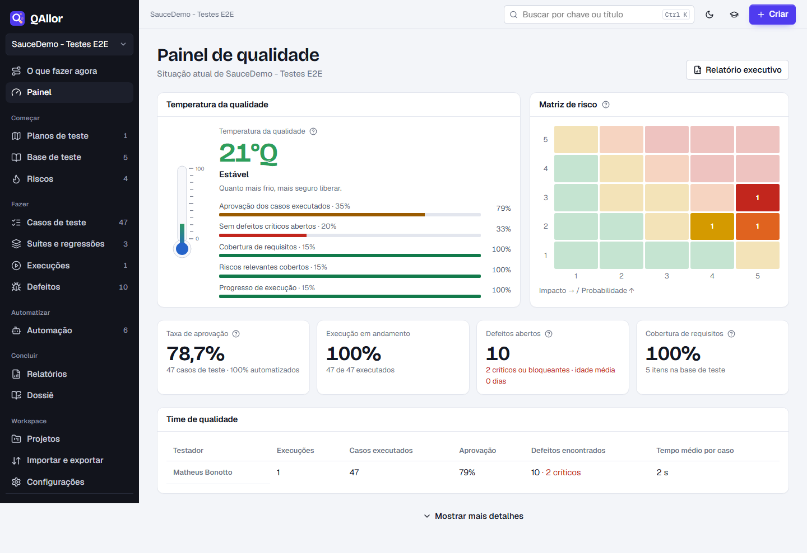
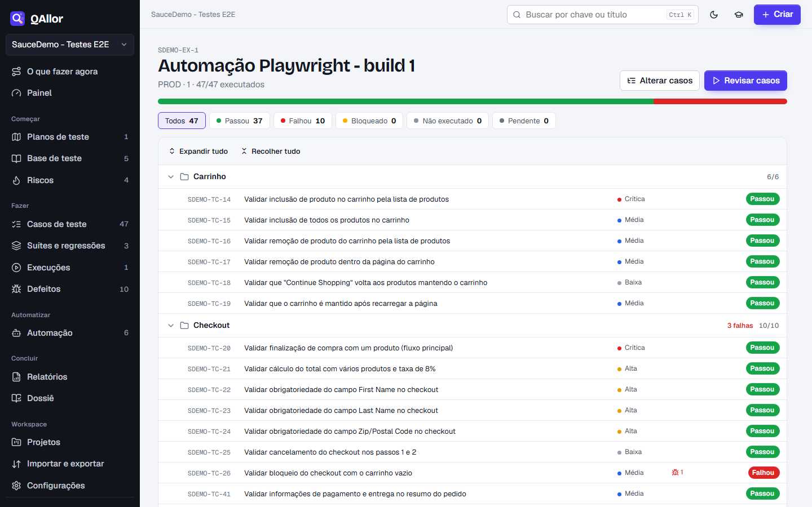

<div align="center">

# 🧪 QA · SauceDemo

**Ciclo de teste completo de uma loja online, do plano ao relatório de conclusão.**
Plano, 47 casos, 10 defeitos reais, automação Playwright com CI e documentos gerados no [QAllor](https://qallor.web.app).

[](https://github.com/matteusbonotto/qa-saucedemo/actions/workflows/testes.yml)
[](https://matteusbonotto.github.io/qa-saucedemo/)


[📄 Plano de teste](docs/plano-de-teste.pdf) · [📊 Resumo de qualidade](docs/resumo-de-qualidade.pdf) · [✅ Relatório de conclusão](docs/relatorio-de-conclusao.pdf) · [🎭 Relatório do Playwright](https://matteusbonotto.github.io/qa-saucedemo/)

</div>

---

## 📌 Resumo

O [SauceDemo](https://www.saucedemo.com) (Swag Labs) é uma loja de demonstração com defeitos colocados de propósito. Conduzi o teste como faria num projeto real:

| Etapa | O que foi feito |
|---|---|
| 🗺️ **Planejamento** | Plano de teste com escopo, riscos, critérios de entrada e saída. 5 requisitos e 4 riscos rastreados. |
| ✍️ **Análise e modelagem** | 47 casos com passos e resultado esperado, em 6 módulos, ligados aos requisitos. |
| 🤖 **Automação** | Os 47 casos automatizados com Playwright + TypeScript, page objects e vigia de erros do console. |
| 🔁 **CI** | GitHub Actions a cada push, PR e toda segunda; relatório publicado no GitHub Pages. |
| 🐞 **Defeitos** | 10 defeitos registrados com passos, esperado, obtido e evidência; 4 achados em testes exploratórios. |
| 🏁 **Conclusão** | Resultado do CI importado no QAllor, que gerou o resumo de qualidade e o relatório de conclusão. |

### Resultado

| Testes | ✅ Passaram | ⚠️ Falha esperada (defeito conhecido) | ❌ Falha nova | Aprovação |
|:-:|:-:|:-:|:-:|:-:|
| 47 | 37 | 10 | 0 | 78,7% |

O critério de saída era de pelo menos 70% (o site tem defeitos que não serão corrigidos). Projeto **concluído** no QAllor em 13/11/2026.

<p align="center"></p>

## 🐞 Defeitos encontrados

| ID | Defeito | Severidade | Caso |
|---|---|:-:|:-:|
| [DF-1](docs/defeitos/SDEMO-DF-1.md) | Checkout permite finalizar pedido com o carrinho vazio | Grave | TC-26 |
| [DF-2](docs/defeitos/SDEMO-DF-2.md) | problem_user: todos os produtos mostram a mesma imagem | Leve | TC-30 |
| [DF-3](docs/defeitos/SDEMO-DF-3.md) | problem_user: ordenação da lista não funciona | Grave | TC-31 |
| [DF-4](docs/defeitos/SDEMO-DF-4.md) | problem_user: campo Last Name não aceita o texto digitado | 🔴 Crítica | TC-32 |
| [DF-5](docs/defeitos/SDEMO-DF-5.md) | error_user: botão Finish não conclui o pedido | 🔴 Crítica | TC-33 |
| [DF-6](docs/defeitos/SDEMO-DF-6.md) | performance_glitch_user: login demora cerca de 5 segundos | Leve | TC-34 |
| [DF-7](docs/defeitos/SDEMO-DF-7.md) | Ordenação volta para Name (A to Z) ao sair do detalhe | Leve | TC-40 |
| [DF-8](docs/defeitos/SDEMO-DF-8.md) | Campo Zip/Postal Code aceita letras | Leve | TC-42 |
| [DF-9](docs/defeitos/SDEMO-DF-9.md) | Checkout aceita nome, sobrenome e CEP só com espaços | Grave | TC-43 |
| [DF-10](docs/defeitos/SDEMO-DF-10.md) | visual_user: imagem, preços e botão diferentes do standard_user | Grave | TC-47 |

Planilhas: [casos-de-teste.csv](docs/casos-de-teste.csv) · [defeitos.csv](docs/defeitos.csv)

## 🗂️ Estrutura

```text
qa-saucedemo/
├── docs/                      📄 artefatos do ciclo de teste
│   ├── plano-de-teste.pdf
│   ├── resumo-de-qualidade.pdf
│   ├── relatorio-de-conclusao.pdf
│   ├── defeitos/              🐞 uma ficha por defeito (SDEMO-DF-1 a 10)
│   ├── casos-de-teste.csv · defeitos.csv
│   ├── prints/                🖼️ telas do projeto no QAllor
│   └── qalor/sdemo.qalor.json fonte dos casos e defeitos (exportada do QAllor)
├── testes-funcionais/         ✍️ os 47 casos por módulo, com passos e resultado esperado
├── automacao/                 🤖 Playwright + TypeScript
│   ├── pages/                 page objects (Login, Produtos, Carrinho, Checkout, Menu)
│   ├── fixtures/console.ts    vigia de erros de JavaScript + helper de defeito conhecido
│   ├── tests/                 6 suítes · o título de cada teste começa com o ID do caso
│   └── scripts/               qalor-export.mjs (resultado → QAllor) · gerar-docs.mjs (QAllor → docs)
└── .github/workflows/         🔁 CI: tipos, testes, resumo e publicação do relatório
```

## ▶️ Rodar a automação

```bash
cd automacao
npm ci
npx playwright install chromium
npm test             # roda os 47 testes
npm run report       # abre o relatório HTML
npm run qalor        # gera resultados/qalor-execucao.json para importar no QAllor
```

## 🧭 Decisões técnicas

- **Defeito conhecido é falha esperada.** Os casos com defeito usam `test.fail()` com o ID do defeito anotado: a suíte continua verde e, se algum defeito for corrigido, o Playwright avisa.
- **Console limpo é critério.** Todo teste vigia o navegador (`fixtures/console.ts`): erro de JavaScript não tratado reprova o teste, mesmo que a tela pareça certa. `console.error` de terceiros vai só anexado.
- **Rastreabilidade de ponta a ponta.** Caso, teste automatizado, resultado do CI e defeito usam a mesma chave (`SDEMO-TC-26` → `SDEMO-DF-1`); o QAllor importa o resultado pela chave.
- **Evidência sempre disponível.** Print, vídeo e trace ficam salvos em toda falha e publicados com o relatório.

## 🔁 Do CI ao relatório de conclusão

1. O workflow roda os testes e publica o relatório em [matteusbonotto.github.io/qa-saucedemo](https://matteusbonotto.github.io/qa-saucedemo/), junto com o `qalor-execucao.json`.
2. No QAllor: **Importar e exportar → Importar documentos** com esse arquivo. Nasce a execução "Automação Playwright · build N", os casos ficam marcados como automatizados e as falhas já chegam ligadas aos defeitos.
3. Em **O que fazer agora → Concluir projeto**, o QAllor confere os critérios de saída e gera o relatório de conclusão e o resumo de qualidade em PDF.

<p align="center"></p>

## 💡 Lições para um projeto real

- **Um problema, um defeito.** O mesmo bug visto em execuções diferentes é vinculado ao defeito aberto, não registrado de novo.
- **Shift-left nas validações.** CEP com letras, campos só com espaços e checkout com carrinho vazio deveriam ser barrados no refinamento, com critérios de aceite de máscara e sanitização no front e no back.
- **Personas de erro só em homologação.** Contas como `problem_user` e `error_user` servem para QA e não devem existir em produção.

---

<div align="center">

Feito por **[Matheus Bonotto](https://matheusbonotto.com.br)** · QA Engineer
Plano, casos e relatórios gerados no **[QAllor](https://qallor.web.app)**: *Qualidade a todo vapor.*

</div>
